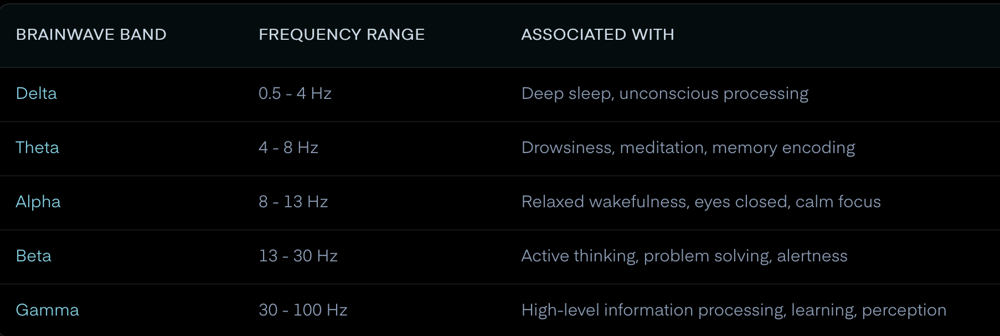

# Electroencephalography

==Listen to electrical activity under someone's scalp using sensors.==

A neuron firing alone doesn't produce enough electricity to be detected.

Millions of neurons firing at the same time = group of people clapping in a stadium.

**EEG signals:**

